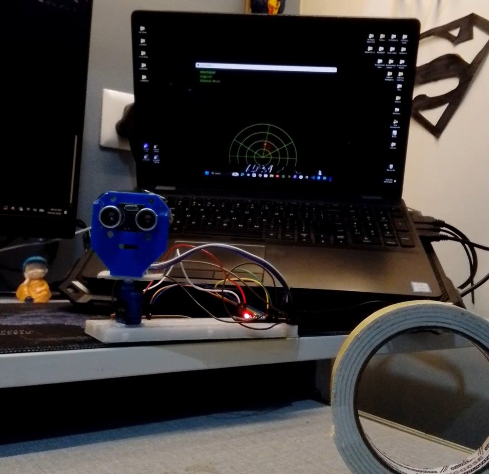

# Mini Radar

Mini Radar is an Arduino project that uses an ultrasonic sensor mounted on a servo motor to scan for nearby objects.

The Arduino measures distance at different angles and sends the angle and distance values to a laptop through serial communication. A Processing sketch displays the readings as a radar visualization.

## Current Progress

- Servo scanning works
- HC-SR04 distance measurement works
- Angle and distance values are sent through serial communication
- Laptop radar visualization works
- CAD component assembly created in Onshape

## Components

- Arduino Nano
- HC-SR04 ultrasonic sensor
- SG90/MG90 servo motor
- Jumper wires
- USB cable
- Breadboard
- Ultrasonic sensor mount
- Laptop

## Connections

### HC-SR04 Ultrasonic Sensor

| HC-SR04 pin | Arduino Nano |
|---|---|
| VCC | 5V |
| GND | GND |
| TRIG | D7 |
| ECHO | D6 |

### Servo Motor

| Servo wire | Arduino Nano |
|---|---|
| Signal (yellow) | D9 |
| VCC (red) | 5V |
| GND (brown) | GND |

*These connections document the current design. Check them against the actual hardware before reconnecting components.*

## Circuit Diagram

[Open the editable circuit in Cirkit Designer](https://app.cirkitdesigner.com/project/3f4ae7ae-e22a-4c27-bb59-d948dd57e46b)

## How It Works

1. The servo rotates the ultrasonic sensor through different angles.
2. The HC-SR04 measures the distance to nearby objects.
3. The Arduino converts the measurement into a distance in centimetres.
4. The Arduino sends the angle and distance through serial communication at 9600 baud.
5. Processing reads the serial data and displays the radar visualization on the laptop.

Example serial output:

\`\`\`text
180,42
179,41
178,40
177,38
\`\`\`

The first value represents the servo angle in degrees, and the second represents distance in centimetres.

## Software

- Arduino IDE — Arduino sketch
- Processing — laptop radar visualization

## Project Files

| File | Description |
|---|---|
| `mini_radar.ino` | Arduino Nano code for servo scanning, ultrasonic distance measurement, and serial communication. |
| `radar_visualization.pde` | Processing sketch that receives serial data and displays the radar visualization. |

## CAD Design

The Mini Radar enclosure and component layout are being documented using Onshape.

### CAD Assembly Preview

### Enclosure File

Add the link to your existing enclosure STL here once you confirm its exact filename and folder.

The assembly uses simplified component placeholders to illustrate the intended layout. Physical dimensions, mounting points, and fit have not yet been verified against the actual hardware.

## Project Photos

## Working Demo

[Watch the Mini Radar working](20260930_213449.mp4)

## What I Learned

This project helped me understand servo control, ultrasonic distance measurement, and serial communication between an Arduino and a computer. I also learned how to visualize sensor readings using Processing and how to represent electronic components in a CAD assembly.

## Next Steps

- Review the sensor mount and enclosure.
- Verify component placement against the actual hardware.
- Test the assembled design and capture updated progress photos.
